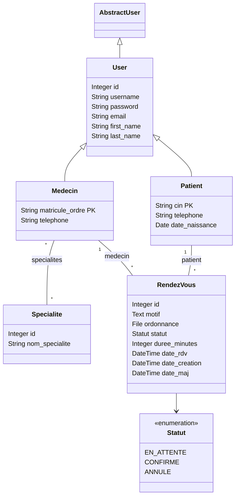

# Case Study

**Medical Practice Appointment Management**

*Academic Year 2026–2027*

**Source:** [Original case study](https://docs.google.com/document/d/1g2IsbJFlF6IzqiRNFdevKbZ-xoR8TJ7S/edit)

English translation of the original assignment. Model names, field names and technical requirements are preserved.

---

The goal of this workshop is to develop a web application for managing the appointments of a medical practice using the Django framework, covering both the Back-Office and Front-Office, along with a REST API exposed via Django REST Framework.

The application revolves around four business entities — **Medecin** (Doctor), **Patient**, **Specialite** (Specialty) and **RendezVous** (Appointment) — two of which (Medecin and Patient) inherit from Django's User entity so they can authenticate.

A central appointment table links a doctor and a patient, and a true many-to-many classification relationship links doctors to their specialties.

## Class Diagram

**User** *(django.contrib.auth.models)*

| Attribute | Type |
|---|---|
| id | Integer |
| username | String |
| password | String |
| email | String |
| first_name | String |
| last_name | String |

**Medecin** (inherits User)

| Attribute | Type | Constraint |
|---|---|---|
| matricule_ordre | String | PK, length = 6 |
| telephone | String | 8 digits |

**Patient** (inherits User)

| Attribute | Type | Constraint |
|---|---|---|
| cin | String | PK, 8 digits |
| telephone | String | 8 digits |
| date_naissance | Date | < today |

**Specialite**

| Attribute | Type |
|---|---|
| id | Integer |
| nom_specialite | String |

**RendezVous**

| Attribute | Type | Constraint / Default |
|---|---|---|
| id | Integer | |
| motif | Text | |
| ordonnance | File [0..1] | .pdf |
| statut | Statut | default = EN_ATTENTE |
| duree_minutes | Integer | default = 30 |
| date_rdv | DateTime | > now |
| date_creation | DateTime | |
| date_maj | DateTime | |

**Statut** *(enumeration, used by RendezVous)*

| Value | Label |
|---|---|
| EN_ATTENTE | En attente (Pending) |
| CONFIRME | Confirmé (Confirmed) |
| ANNULE | Annulé (Cancelled) |

### Relationships



### Associations Between Classes

| Source class | Target class | Multiplicity | Role / Name |
|---|---|---|---|
| RendezVous | Medecin | * — 1 | praticien (field `medecin`) |
| RendezVous | Patient | * — 1 | demandeur (field `patient`) |
| Medecin | Specialite | * — * | Simple ManyToManyField (field `specialites`) |
| User | AbstractUser | Inheritance | — |
| Medecin | User | Inheritance | — |
| Patient | User | Inheritance | — |

**User** is a model that inherits from **AbstractUser**.

**Medecin** and **Patient** both inherit from **User** (multi-table inheritance): every doctor and every patient is also a Django user and therefore already has a username, a password, an email, a first name (`first_name`) and a last name (`last_name`), which must not be redeclared.

**RendezVous** is a standalone associative entity: it has its own identifier and two simple foreign keys (to Medecin and to Patient).

Conceptually, it links doctors and patients, but the same doctor–patient pair can have several appointments, so it is modeled neither with a `ManyToManyField` nor with a `through` class.

The only **ManyToManyField** in the model links **Medecin** and **Specialite** directly, without a custom `through` class.

---

## I. Project Setup

- Django 5.2 (LTS version).
- Python 3.12.
- Create a virtual environment named `env`.
- Create a project named `GestionCabinetMedical`.
- Create two applications:
  - `Cabinet`: contains the models User, Specialite, Medecin and Patient.
  - `RendezVous`: contains the model RendezVous.

---

## II. Database Generation

### 1. Model Implementation

Develop the entities in the `models.py` file of each application (User, Specialite, Medecin and Patient in `Cabinet`; RendezVous in `RendezVous`), based on the class diagram above and respecting the following constraints.

#### User

The `User` model inherits from the predefined `AbstractUser` entity.

> **Translator's note:** The original document mentions `from django.contrib.auth.models import User`. The correct import for the required inheritance is `from django.contrib.auth.models import AbstractUser`.

The `Medecin` and `Patient` models both inherit from the `User` entity.

Inherited attributes must not be redeclared: the patient's last name and first name correspond to `last_name` and `first_name`.

Change the primary key `id` of both models:

- In `Medecin`, it becomes `matricule_ordre`, which must have a fixed length of 6 (`max_length=6` and `MinLengthValidator(6)`).
- In `Patient`, it becomes `cin`, made of exactly 8 digits (`max_length=8` and `RegexValidator(r'^\d{8}$')`).

Django automatically keeps the `user_ptr` link to `User`.

```python
class User(AbstractUser):
    email = models.EmailField("e-mail address", unique=True)


class Medecin(User):
    matricule_ordre = models.CharField(
        max_length=6,
        primary_key=True,
        validators=[MinLengthValidator(6)]
    )


class Patient(User):
    cin = models.CharField(
        max_length=8,
        primary_key=True,
        validators=[RegexValidator(r'^\d{8}$')]
    )
```

#### Telephone Validation

The `telephone` attribute (on `Medecin` and on `Patient`) must follow the Tunisian 8-digit format.

Since both models are in the same file, declare a single `RegexValidator` and reuse it:

```python
r'^\d{8}$'
```

#### Specialite

The `Specialite` model contains only one business field, `nom_specialite`, representing an open list (e.g. Cardiology, Dermatology, Pediatrics).

It is linked to `Medecin` by a classic `ManyToManyField` without an intermediate class, because the relationship carries no additional data.

#### Patient

The `Patient` model must respect the following constraints:

- `cin` is the primary key and is therefore unique.
- `date_naissance` must be earlier than today's date (validation in `clean()` or via a validator).

#### RendezVous

The `RendezVous` model must respect the following constraints:

- `motif` must be a `TextField`.

- `ordonnance` must be a `FileField` (scanned attachment, uploaded by the doctor after the consultation). It is therefore optional (`blank=True`), with `upload_to='ordonnances/'` and a validator restricting the extension to `.pdf` (`FileExtensionValidator`). Configure `MEDIA_URL` and `MEDIA_ROOT` in `settings.py`.

- `statut` must be a choice list:
  - Pending (En attente).
  - Confirmed (Confirmé).
  - Cancelled (Annulé).

  The default value is Pending. Using `models.TextChoices` is recommended.

- `duree_minutes` must be a `PositiveIntegerField` with `default=30`.

- `date_creation` (`auto_now_add=True`) and `date_maj` (`auto_now=True`) are filled in automatically.

- `RendezVous` has two distinct foreign keys:
  - `medecin`: `ForeignKey` to `Medecin`.
  - `patient`: `ForeignKey` to `Patient`.

  These are not symmetric roles of a single relationship, but two independent one-to-many relationships.

  Since these models are in the other application, reference them by their full name: `'Cabinet.Medecin'` and `'Cabinet.Patient'`.

- `date_rdv` must be later than the current date and time. Implement this rule in the model's `clean()` method, comparing with `django.utils.timezone.now()`.

  The rule applies on creation or when the date is modified. A past appointment must remain editable, for example, to add the prescription.

- Declare the `Meta` class in which the uniqueness constraint is defined: the same doctor cannot have two appointments at the same `date_rdv`.

  Use `UniqueConstraint` (the recommended form, which replaces `unique_together`), and order appointments by `date_rdv`:

```python
class Meta:
    ordering = ['date_rdv']
    constraints = [
        models.UniqueConstraint(
            fields=['medecin', 'date_rdv'],
            name='unique_medecin_date_rdv'
        ),
    ]
```

#### Notes

> The rule "`date_rdv` later than now" must not be declared as a `CheckConstraint` in `Meta`: a database constraint cannot depend on the current time in this context (SQLite rejects `Now()` in a CHECK, and `datetime.now()` would be frozen at the date the migration was generated).
>
> It would also prevent confirming or cancelling an appointment that is already in the past.

> Validators and `clean()` are run by forms (`ModelForm`, admin) and by `full_clean()`, but not by `save()`.

> A primary key (`matricule_ordre`, `cin`) must not be modified after creation: Django would treat the object as a new record linked to the same user (`IntegrityError` on `user_ptr`).

### 2. Database Configuration

Modify the `settings.py` file so that the database name matches the name of your university class.

### 3. Generate Migration Files

```bash
python manage.py makemigrations Cabinet RendezVous
```

### 4. Generate the Database Schema

```bash
python manage.py migrate
```